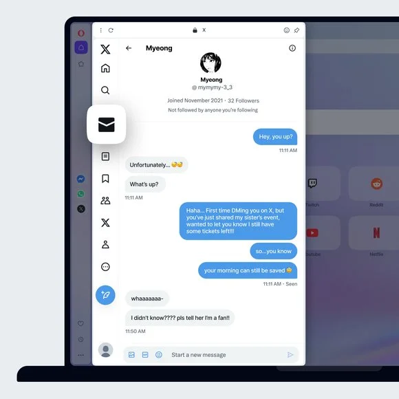
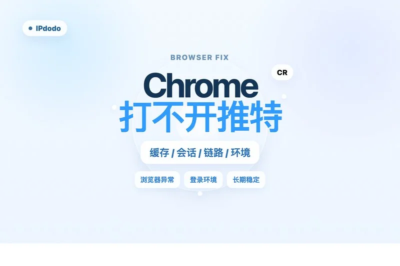

买Twitter（X）账号不是「给钱拿号」那么简单。结合X平台真实登录/注册界面（X注册教学、DM私信界面、IPdodo BROWSER FIX），本文拆解「twitter账号购买流程」每一步，避免踩坑。

## 一、完整购买流程总览

标准「twitter购买流程」分六步：

```
选号 → 验号 → 下单 → 付款 → 交接 → 安全设置
```

每个环节都有具体动作和验收标准，缺一不可。

## 二、选号：明确需求再下手

「twitter选号教程」第一步是定需求：
- **用途**：运营/推广/私域/数据采集
- **类型**：老号（权重高）/新号（成本低）/成品号（开箱即用）
- **数量**：单号或「小号批发」
- **预算**：对比「twitter价格表」控制成本

筛选标准：注册时间≥6个月、有真实活跃记录、完成基础验证、无封禁历史。

## 三、验号：先验后买是铁律

「twitter账号验证方法」核心是**要求卖家提供真实证据**：
1. **登录截图**：账号已登录状态（含头像、用户名、主页）
2. **注册时间证明**：账号信息页「Joined」时间
3. **验证状态**：邮箱/手机/蓝V是否完成
4. **健康度**：粉丝数、关注数、帖子数是否正常

拒绝「只发账号密码，不给截图」的卖家——大概率是死号或黑号。

## 四、下单付款：走正规通道

「twitter账号下单」注意事项：
- **平台担保**：选择支持担保交易的「twitter购买平台」
- **支付记录**：保留付款凭证（订单号、流水）
- **勿私下转账**：直接转给个人无保障

## 五、交接与登录

获取账号后，第一时间：
1. **登录测试**：用IPdodo BROWSER FIX修复环境，确保Chrome能正常打开X
2. **修改密码**：换成强密码（大小写+数字+符号）
3. **解绑旧邮箱**：解绑卖家邮箱，绑定个人邮箱
4. **开启2FA**：两步验证（验证器APP优先）
5. **检查设备**：查看「登录设备」是否有异常IP

## 六、常见问题与避坑

| 问题 | 原因 | 解决 |
|------|------|------|
| 登录失败 | 密码错误/账号锁定 | 立即联系卖家售后 |
| 敏感内容过滤 | 新号默认开启 | 设置→隐私→关闭过滤 |
| Chrome打不开 | 浏览器环境异常 | IPdodo BROWSER FIX修复 |
| 账号被找回 | 卖家预留邮箱 | 立即解绑+改密+2FA |

<figure class="post-figure"></figure>
<figure class="post-figure"></figure>

---

**关键词**：twitter账号购买流程、twitter购买流程、twitter选号教程、twitter账号下单、twitter账号验证方法、twitter小号批发、twitter价格表、twitter购买平台、2FA两步验证、IPdodo BROWSER FIX、Chrome打不开推特、X注册教学、DM私信