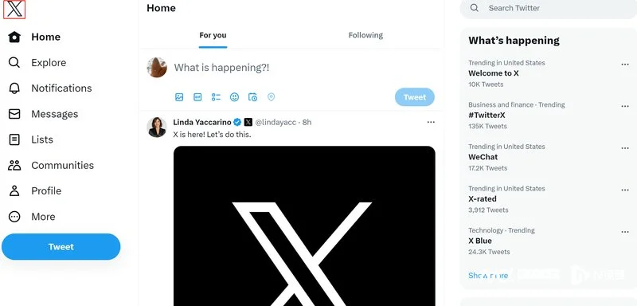

「twitter账号类型」是购买前必须先搞懂的基础。结合X平台真实界面（X官方主页@X、Twitter网页版、X首页品牌更名），本文从特点、价格、适用场景三维度，帮你精准选号。

## 一、Twitter老号

**特点**：注册时间久（2020年前）、历史活跃完整、权重高、信任度强。参考@elonmusk（Joined June 2009、149.2M Followers），早期注册是强信号。

**适用**：长期品牌运营、高权重内容推广。
**价格**：偏高（200-800元）。
**注意**：确认无封禁历史、无异常登录、邮箱可解绑。

## 二、Twitter新号

**特点**：注册时间短、价格低、需自行养号。适合快速启动。
**适用**：测试项目、短期运营。
**价格**：亲民（5-50元）。
**注意**：新号前7天是风险期，需正常浏览互动养号。

## 三、Twitter成品号

**特点**：已完成基础养号+验证（邮箱/手机），开箱即用。
**适用**：直接上手运营、无养号时间成本。
**价格**：中等（50-200元）。
**注意**：要求卖家提供登录截图+验证记录。

## 四、Twitter蓝V认证号

**特点**：官方蓝V/金V标识，信任度高。参考X官方账号（@X、15K posts）认证标识。
**适用**：企业认证、高信任场景。
**价格**：高（300-2000+元）。
**注意**：确认认证类型（个人/企业）、认证是否可续。

## 五、Twitter小号批发

**特点**：批量采购、单价优惠。
**适用**：工作室、批量运营。
**价格**：3-10元/个。
**注意**：账号质量统一性，避免个体差异。

## 六、其他类型补充

- **半旧号**：注册久但未完全养号，性价比高
- **国外号源**：美/欧/日IP，环境稳定
- **国内号**：需加强养号
- **混合号**：老号权重+新号灵活性

## 七、选号决策建议

结合X界面参考（Who to follow推荐、Trends趋势榜）：
1. **看需求**：长期→老号；短期→新号；即用→成品号
2. **看预算**：预算足→蓝V号；预算紧→新号+养号
3. **看场景**：企业→蓝V；工作室→批发；个人→成品号
4. **看参考**：用@elonmusk、@X等真实账号作健康度参照

<figure class="post-figure"></figure>
<figure class="post-figure"></figure>

---

**关键词**：twitter账号类型、twitter老号、twitter新号、twitter成品号、twitter蓝V认证号、twitter小号批发、twitter半旧号、twitter国外号源、twitter国内号、twitter混合号、@elonmusk、X官方账号、Who to follow、Trends for you