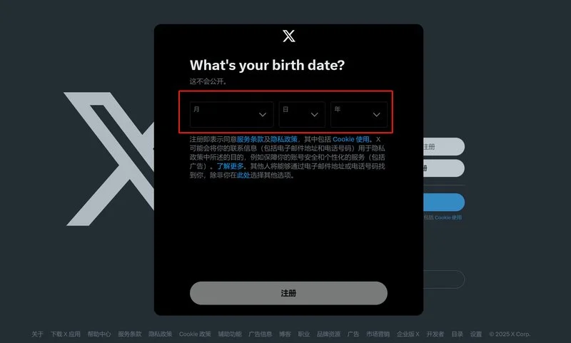

想注册Twitter（现X），最头疼的就是手机号验证和敏感内容限制。本文提供「X（Twitter）注册教学」完整流程，实现「100%轻松注册」，解决「无需大陆手机号」和「解除敏感」两大核心痛点。

## X注册核心痛点解析

Twitter/X注册时常遇到三大难题：
1. **大陆手机号无法接收验证码** - 国内号段常被风控拦截
2. **敏感内容限制** - 新号默认开启敏感内容过滤，影响使用体验
3. **浏览器环境异常** - Chrome打不开推特，需「BROWSER FIX」修复缓存/会话/链接/环境

## 完整注册流程（100%轻松注册）

### 步骤一：准备环境
使用IPdodo BROWSER FIX方案，从「缓存/会话/链接/环境」四维度修复Chrome浏览器，确保「长期稳定」访问X.com。建议开启无痕模式，避免Cookie干扰。

### 步骤二：填写基础信息
访问X.com，点击「注册」，填写：
- **姓名**：建议使用真实或常用昵称
- **手机号/邮箱**：推荐使用国外虚拟手机号或Gmail/Outlook邮箱（无需大陆手机号）
- **出生日期**：按「Month / Day / Year」格式填写，**This will not be public**

### 步骤三：验证与设置
完成邮箱/手机验证后，立即前往「设置-隐私与安全」：
- 关闭「显示可能包含敏感内容的媒体」过滤 → 实现「解除敏感」
- 开启「两因素认证」（推荐验证器APP）
- 完善个人资料（头像、简介、Header图）

### 步骤四：账号养号建议
新号注册后前3-7天为高风险期，建议：
- 每日登录1-2次，浏览主页、搜索话题
- 关注5-10个相关领域大V（如@elonmusk、@lindayacc）
- 适当点赞、转发，避免高频操作触发风控
- 7天后可正常发推、回复

## IPdodo BROWSER FIX：Chrome打不开推特终极方案

针对「Chrome打不开推特」、「浏览器易异常」、「登录环境」不稳定等问题，IPdodo提供「BROWSER FIX」专项修复：
- **缓存清理**：清除过期Cookie、Service Worker、IndexedDB
- **会话恢复**：修复损坏的登录会话状态
- **链接检测**：排查DNS污染、CDN节点异常
- **环境配置**：优化User-Agent、指纹、时区一致性

承诺「长期稳定」，一次配置持久生效，适合「登录环境」要求高的运营场景。

## 常见问题FAQ

**Q：注册时提示手机号已被使用？**
A：更换未注册过的国外虚拟号段，或改用邮箱注册。

**Q：新号发推无人看/被限流？**
A：完成基础养号（7天正常浏览互动），避免发布营销广告内容。

**Q：敏感内容设置找不到？**
A：网页版：设置→隐私与安全→你的推文→勾选「标记包含敏感内容的媒体」；App端同路径。

**Q：Chrome一直转圈/白屏？**
A：使用IPdodo BROWSER FIX修复「缓存/会话/链接/环境」，或更换节点IP。

## 进阶技巧：从Elon Musk账号看权重号特征

观察@elonmusk账号（1.49亿Followers，2009年6月注入）：
- 早期注册时间 = 高权重信号
- 真实身份验证（蓝V/金V）= 信任背书
- 高频原创内容 = 算法偏好
- 互动率稳定 = 账号健康度指标

购买成品号时，可参考以上指标筛选「twitter老号」「twitter已验证号」「twitter蓝V认证号」。

<figure class="post-figure"></figure>
<figure class="post-figure"></figure>

---

**关键词**：X（Twitter）注册教学、100%轻松注册、无需大陆手机号、解除敏感、IPdodo BROWSER FIX、Chrome打不开推特、缓存会话链接环境、长期稳定、Month Day Year、This will not be public、twitter老号、twitter已验证号、twitter蓝V认证号